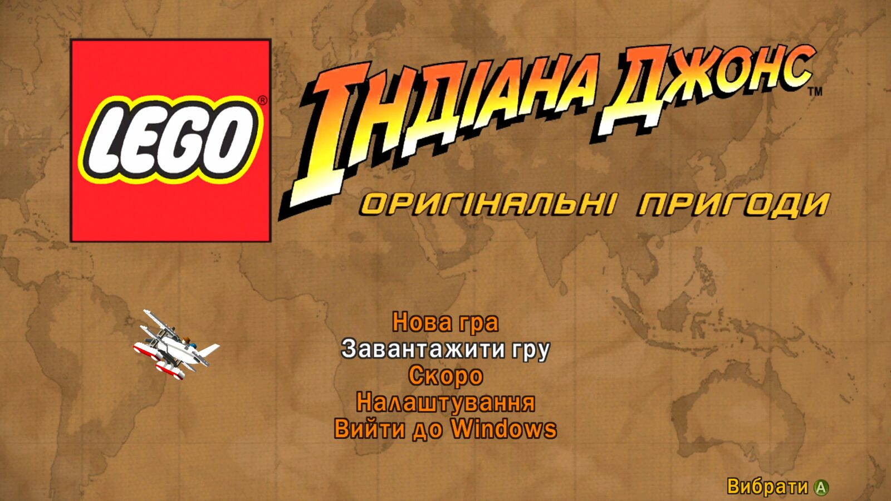
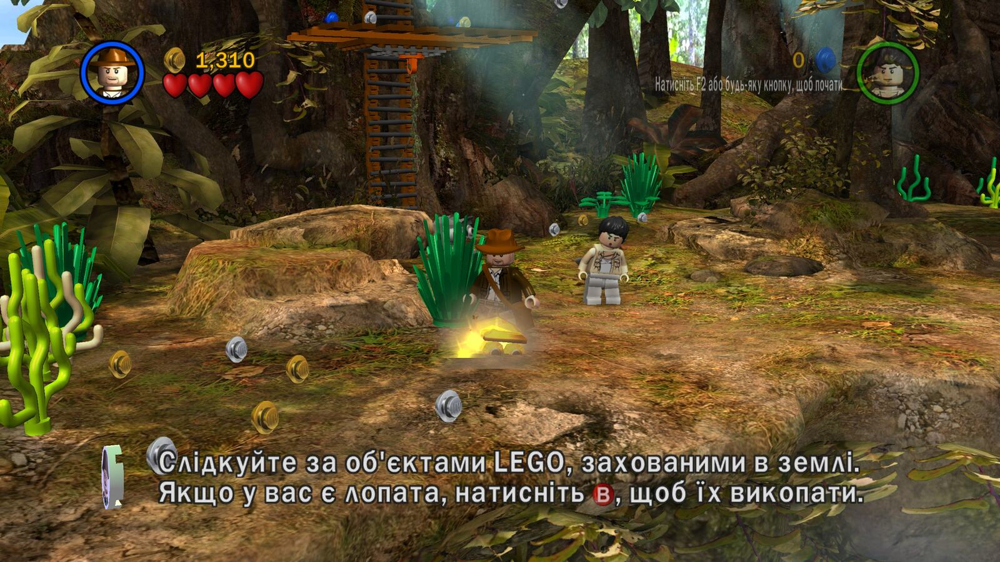
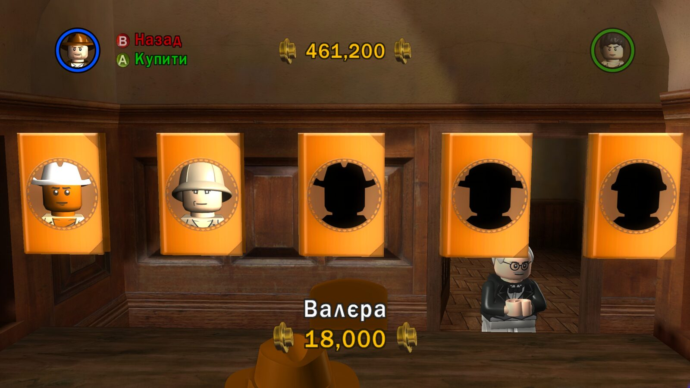
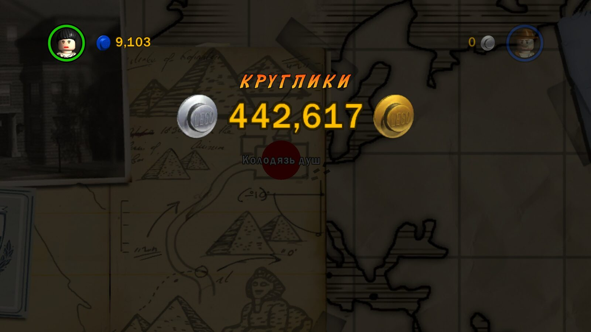
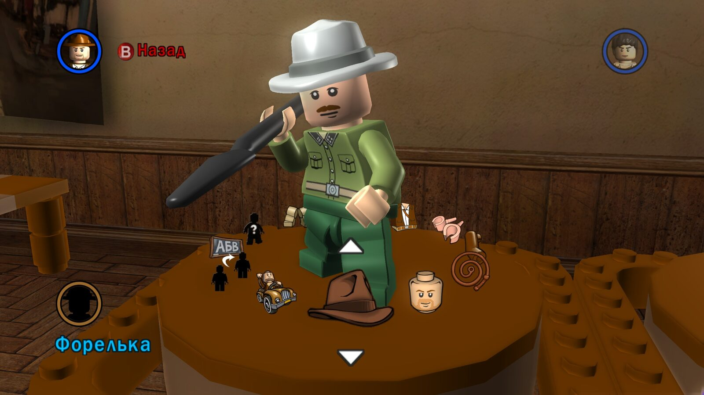

<p align="center">
  
</p>

# LEGO Індіана Джонс: Оригінальні пригоди — українізатор

[](https://github.com/DrSmile444/lego-indiana-jones-ua/releases/latest)
[](https://github.com/DrSmile444/lego-indiana-jones-ua/releases/latest)
[](https://drsmile444.github.io/lego-indiana-jones-ua/)

Фанатська українська локалізація **LEGO Indiana Jones: The Original Adventures**
(TT Games, 2008) для PC-версії зі Steam. Перекладено весь текст гри, PC-меню,
написи на текстурах і логотип, а до шрифтів гри додано літери `І і Ї ї Є є Ґ ґ`.

**Статус: повний переклад.** Помітили помилку? [Напишіть нам](#зворотний-звязок):
кожен звіт допомагає.

**[⬇ Завантажити останню версію](https://github.com/DrSmile444/lego-indiana-jones-ua/releases/latest)**
· [Сайт проєкту](https://drsmile444.github.io/lego-indiana-jones-ua/)
· [Історія змін](CHANGELOG.md)

## Встановлення

1. Завантажте `lego-indiana-jones-ua-1.1.10.zip` зі сторінки
   [останнього релізу](https://github.com/DrSmile444/lego-indiana-jones-ua/releases/latest).
2. Розпакуйте весь архів у теку гри, поруч із `LEGOIndy.exe`
   (Steam → ПКМ на грі → «Керувати» → «Переглянути локальні файли»).
3. Запустіть гру через Steam. Мова гри в Steam має бути **англійська**:
   переклад замінює саме англійську мову.

Архів містить шість файлів:

```text
dinput8.dll                         Ultimate ASI Loader 9.7.4 (x86, ThirteenAG)
scripts/UKRAINIAN.asi               плагін локалізації
scripts/UKRAINIAN.uap               пакет перекладу: тексти, шрифти, текстури
scripts/UKRAINIAN/README.txt        інструкція
scripts/UKRAINIAN/LICENSE.txt       ліцензії проєкту
scripts/UKRAINIAN/LICENSE-ASI-Loader.txt
```

Оригінальні `.DAT`-архіви та `LEGOIndy.exe` **не змінюються**: переклад
підставляється в пам'яті під час гри.

### Видалення

Закрийте гру й видаліть `scripts/UKRAINIAN.asi`, `scripts/UKRAINIAN.uap` і
теку `scripts/UKRAINIAN/`. Файл `dinput8.dll` видаліть, якщо у вас немає
інших ASI-модів. Гра повернеться до англійської; збереження не зачіпаються.

### Сумісність

| Версія гри | Статус |
|---|---|
| Steam, Windows | ✅ Перевірено |
| Steam Deck / Proton | ✅ Перевірено автором (1.1.10) |
| GOG | ❔ Не перевірялася |
| Інші видання, піратські збірки, змінений EXE (зокрема LAA-патч) | ❌ Не підтримуються |

Плагін перевіряє контрольну суму `LEGOIndy.exe`. Якщо ваша версія відрізняється,
гра просто запуститься англійською, нічого не зламавши. Якщо ви грали в GOG-версію,
[розкажіть, що вийшло](#зворотний-звязок): так статус
оновиться за реальною перевіркою.

## Скриншоти

| | |
|---|---|
|  |  |
|  |  |

Більше знімків — на [сайті](https://drsmile444.github.io/lego-indiana-jones-ua/)
і в теці [docs/screenshots](docs/screenshots/).

## Що перекладено

- **Основний текст гри** — усі 598 рядків `ENGLISH.TXT`: меню, підказки,
  імена персонажів, назви рівнів і бонусів.
- **Діалоги збереження й системні повідомлення** — `TRC.CSV` (194 значення).
- **Титри** — назви посад і розділів. Імена людей і студій свідомо лишилися в оригіналі.
- **PC-меню** — 38 рядків, вшитих у `LEGOIndy.exe`: «Вийти до Windows»,
  налаштування відео й ефектів, значення параметрів.
- **Шрифти** — основний шрифт інтерфейсу і фірмовий «пригодницький» шрифт
  екранів завершення рівня отримали `І і Ї ї Є є Ґ ґ`.
- **Графіка** — 9 текстур: логотип «Індіана Джонс» і підзаголовок
  «Оригінальні пригоди», стартовий екран, вивіски Венеції, панель приладів
  у замку, дошка «АБВ» у редакторі персонажа, ілюстрація коледжу.
- **Редактор власних персонажів** — українські імена показуються повністю;
  початкові імена — «Форелька» та «Льоля».
- **Культурні адаптації** — «Валєра», «Пластун», «Шанхайський батяр»,
  «круглики» замість studs. Чому саме так — у
  [docs/research/cultural-adaptations.md](docs/research/cultural-adaptations.md).

## Чому весь переклад важить ≈3 МБ

Зазвичай українізатори таких ігор розпаковують архіви гри, замінюють файли й пакують
їх назад. Тоді гравцеві доводиться завантажувати й перезаписувати сотні мегабайтів:
лише `GAME.DAT` займає близько 600 МБ. Ми пішли іншим шляхом: **переклад
підставляється в пам'ять під час гри**.

- **Зберігаємо лише змінене.** Пакет `UKRAINIAN.uap` містить тільки наш текст,
  два шрифти з новими літерами й дев'ять перемальованих текстур. Коли гра просить
  такий файл, плагін віддає нашу версію; решту гра читає зі своїх архівів, як завжди.
- **Нічого не перезаписується.** `.DAT`-архіви й `LEGOIndy.exe` лишаються побайтово
  оригінальними, тому немає ризику зіпсувати встановлену гру, а оновлення Steam не
  конфліктують із перекладом.
- **Дружить з іншими модами.** Переклад не займає чужих файлів, тож конфліктів через
  перезапис немає. Плагін працює через стандартний Ultimate ASI Loader поряд з іншими
  ASI-плагінами (перевірено другим тестовим плагіном).
- **Безпечний у найгіршому випадку.** Якщо версія гри інша або пакет пошкоджений,
  плагін нічого не змінює: гра просто запускається англійською. Обидва випадки
  перевірено навмисно зіпсованим і відсутнім пакетом.

Як це влаштовано всередині — в [docs/architecture.md](docs/architecture.md).

## Як ми це робили

Гра не підтримує жодної мови з українськими літерами, і в ній немає
інструментів для перекладу. Тому довелося розібрати формати ресурсів рушія TT Games,
знайти в пам'яті гри функції читання ресурсів і таблиці PC-меню, перемалювати
літери в атласі шрифту й написати плагін, який підставляє переклад на льоту.

Кожен рядок перекладено з урахуванням того, де саме він з'являється в грі,
звірено з глосарієм (офіційний український дубляж трилогії, українська Вікіпедія)
і перевірено в живій грі. У дослідженні, розпакуванні та підготовці чернеток
допомагав ШІ-асистент. Ідея, глосарій, рішення, вичитка й перевірка в грі — за автором.
Чесний розподіл ролей і весь процес описано в [docs/approach.md](docs/approach.md).

## Інструменти

| Інструмент | Для чого |
|---|---|
| [TT Font Studio](https://github.com/DrSmile444/tt-font-studio) | редактор шрифтів `.FNT` у браузері (власний інструмент автора) |
| [QuickBMS](https://aluigi.altervista.org/quickbms.htm) + [`ttgames.bms`](https://github.com/linterniGamer/Tt-Games-quickbms-scripts) | розпакування `.DAT`-архівів гри |
| [TTGames-Explorer-Rebirth](https://github.com/AcK77/TTGames-Explorer-Rebirth) | довідка щодо формату шрифтів TT Games |
| [TTGames LEGO Documentation](https://github.com/AlubJ/TTGames-LEGO-Documentation), [BactaTank Classic](https://github.com/AlubJ/BactaTank-Classic) | документація й інструменти спільноти моддерів TT |
| [Ultimate ASI Loader 9.7.4](https://github.com/ThirteenAG/Ultimate-ASI-Loader) | завантаження плагіна в гру |
| [Affinity](https://affinity.serif.com/) | рендер гліфів, шари текстур і логотипа |
| [Python 3](https://www.python.org/) + [Pillow](https://pypi.org/project/pillow/) | формати, збірка, перевірки |
| [Visual Studio Build Tools](https://visualstudio.microsoft.com/visual-cpp-build-tools/) (C++ x86) + Windows SDK | збірка нативного плагіна |
| [Claude Code](https://claude.com/product/claude-code), [Codex](https://openai.com/codex/) | ШІ-асистенти в дослідженні й чернетках |

Повний список із версіями, ліцензіями й призначенням — [docs/tooling.md](docs/tooling.md).

## Питання й відповіді

**Антивірус сварить на `dinput8.dll` або `UKRAINIAN.asi`. Це вірус?**
Ні. Обидва файли — бібліотеки, які завантажуються в процес гри й змінюють
дані в його пам'яті. Евристики антивірусів часто реагують на таку поведінку.
`dinput8.dll` — незмінний офіційний Ultimate ASI Loader 9.7.4
(SHA-256 `ec2f4824eca58dd40f425756a4a7cec77b8e381f21d11d7c846ec4b339b617ab`),
а код плагіна відкритий у цьому репозиторії. Контрольні суми всіх файлів
опубліковано разом із релізом.

**У мене вже є `dinput8.dll` від іншого моду.**
Якщо це Ultimate ASI Loader, залиште його й скопіюйте лише теку `scripts`.
Якщо це інша бібліотека, не перезаписуйте її наосліп: два різні `dinput8.dll`
не можуть працювати одночасно.

**Гра лишилася англійською.**
Перевірте, що мова гри в Steam — англійська, а файли лежать поруч із `LEGOIndy.exe`,
а не у вкладеній теці. Якщо EXE змінений (наприклад, LAA-патчем) або це не
Steam-версія, плагін свідомо нічого не робить. Журнал запуску з'являється в
`scripts/legoindy-ua-pc.log`: додайте його до звіту.

**Переклад змінює мої збереження?**
Ні. Зверніть увагу: імена власних персонажів зберігаються в сейві, тож уже
створені імена (наприклад, `Stranger 1`) лишаться як були. «Форелька» й «Льоля»
з'являються в нових іграх. Сейви лежать у
`%LOCALAPPDATA%\LucasArts\LEGOIndianaJones\SavedGames\`.

**Як повернути англійську?**
Видаліть файли, як описано в розділі [«Видалення»](#видалення). Перевіряти
цілісність файлів у Steam не потрібно: оригінальні файли гри не змінювалися.

**Я ставив старі версії 0.1.x.**
Для 0.1.8–0.1.10 просто замініть файли новими. Для 0.1.6–0.1.7 видаліть
`UKRAINIAN.uap` з кореня гри, а старий `dinput8.dll` замініть новим з архіву. Версії
0.1.0–0.1.5 вимагали розпакованої гри: поверніть оригінальні `.DAT`
(найпростіше — «Перевірити цілісність файлів» у Steam), а потім встановіть 1.1.10.

## Зворотний зв'язок

- [GitHub Issues](https://github.com/DrSmile444/lego-indiana-jones-ua/issues/new/choose) —
  шаблони «Помилка в тексті» та «Збій гри або проблема».
- Telegram: [@dimkasmile](https://t.me/dimkasmile) — якщо у вас немає акаунта GitHub.

Опишіть, що сталося, на якому рівні чи екрані, додайте скриншот і, якщо
можете, файл збереження. Це найшвидший спосіб відтворити проблему.

## Для розробників

- [docs/setup.md](docs/setup.md) — як підготувати середовище й зібрати пакет.
- [docs/architecture.md](docs/architecture.md) — як улаштовані UAP, ASI і потік ресурсів.
- [docs/tooling.md](docs/tooling.md) — усі інструменти з версіями.
- [docs/approach.md](docs/approach.md) — процес перекладу й роль ШІ.
- Дослідження: [шрифти](docs/research/fonts.md) ·
  [текстури](docs/research/textures.md) ·
  [PC-меню](docs/research/pc-menu.md) ·
  [завантаження в рантаймі](docs/research/runtime-loading.md) ·
  [редактор персонажів](docs/research/character-editor.md) ·
  [культурні адаптації](docs/research/cultural-adaptations.md).

## Автори й подяки

- **Дмитро Вакуленко** ([DrSmile444](https://github.com/DrSmile444)) — ідея,
  переклад і вичитка, глосарій, графіка, тестування, рішення.
- Luigi Auriemma — QuickBMS; linterniGamer — збірка скриптів `ttgames.bms`.
- ThirteenAG — Ultimate ASI Loader.
- AcK77 — TTGames-Explorer-Rebirth; AlubJ — документація й інструменти для класичних ігор TT.
- Neale Davidson (Pixel Sagas) — шрифт Adventure, основа другого шрифту.
- Анонімний автор сторонньої кириличної латки шрифту, атлас якої став основою першого шрифту.
- Український дубляж трилогії (ICTV, студія «ТВ+») — орієнтир для імен і назв.
- Дмитро Топорець — українізатори LEGO Batman на тому самому рушії, які показали, що це можливо.

## Ліцензії

- Власний код, інструменти й скрипти — [MIT](LICENSES/MIT.txt).
- Власний творчий внесок (переклад, графіка, документація) — [CC BY 4.0](LICENSES/CC-BY-4.0.txt).
- Ресурси гри, сторонні шрифти, донорські матеріали й Ultimate ASI Loader
  під ці ліцензії **не підпадають** і лишаються за своїми правовласниками.

Повні межі застосування — у файлі [LICENSE](LICENSE).

## Дисклеймер

Це неофіційний фанатський проєкт. Він не пов'язаний із The LEGO Group,
Lucasfilm Ltd., LucasArts, TT Games, Warner Bros. Games чи іншими правовласниками
гри й не схвалений ними. LEGO, Indiana Jones та пов'язані назви — торговельні
марки відповідних власників. Для гри потрібна власна легально придбана копія.
Репозиторій і реліз не містять файлів гри.

## About (English)

A fan-made **Ukrainian localization of LEGO Indiana Jones: The Original
Adventures** (TT Games, 2008) for the Steam PC version. It translates all
598 `ENGLISH.TXT` strings, `TRC.CSV`, credits titles, 38 PC menu strings
hard-coded in the EXE, and 9 textures including the title logo. It adds the
Ukrainian letters `ІіЇїЄєҐґ` to both game fonts and fixes UTF-8 names in the
custom character editor.

Installation: unpack the [latest release](https://github.com/DrSmile444/lego-indiana-jones-ua/releases/latest)
next to `LEGOIndy.exe`; the game must run in English. The package is
Ultimate ASI Loader 9.7.4 plus our `UKRAINIAN.asi` plugin and a `UKRAINIAN.uap`
resource pack. Original DAT files and the EXE stay untouched: text, fonts and DDS
textures are substituted in memory through hooks of the engine's resource
reader.

Technical write-ups (in Ukrainian, with code, tables and addresses):
[architecture](docs/architecture.md), [FNT font format and glyphs](docs/research/fonts.md),
[runtime loading](docs/research/runtime-loading.md), [PC menu tables](docs/research/pc-menu.md),
[textures](docs/research/textures.md), [character editor](docs/research/character-editor.md),
[build setup](docs/setup.md), [tools](docs/tooling.md).
Code is MIT, creative work is CC BY 4.0; game assets are not included.
Unofficial fan project, not affiliated with the rights holders.
