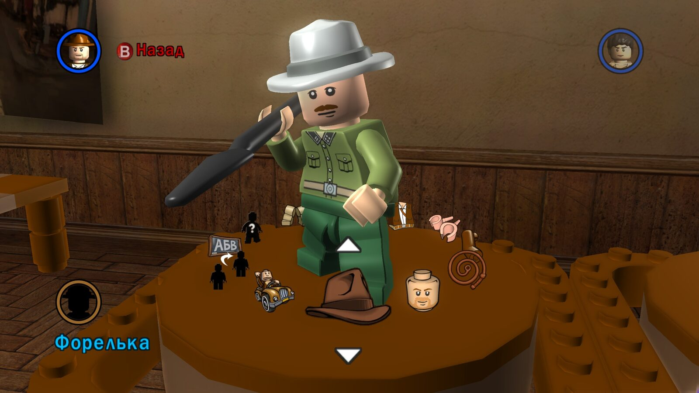

# The custom character editor: names, saves and UTF-8

The game lets you build two custom characters and give them names. This is
where Ukrainian text first left the string tables: the names are stored in
the save file, and the editor processes them with its own code, written with
ASCII in mind.

## Where "Stranger 1" and "Stranger 2" came from

After translation, the editor still showed English names. The cause was not a
missed string: ID 85 (`Stranger`) was already translated. The names were
**literally written into the save**.

When creating the names, the game does the following (Steam EXE):

- the function `0x5F4B40` fetches the localized text of ID 85 through the
  global index `0x9C5948` and the table `0xA90268`;
- it appends a number and formats the string `%s %i` (`0x8287AC`) with a call
  at `0x5F4BB2`;
- it writes the result into the character record at offset `+0x14`; records
  have a stride of `0x38`, base address `0x909C80`.

So a new game takes the names from the active localization, while an old save
keeps whatever is already written in it. Renaming arbitrary names on load is
not an option: the player may have typed them in.

## Save format

Saves are stored in `%LOCALAPPDATA%\LucasArts\LEGOIndianaJones\SavedGames\`
(for example, `SaveGame0.LEGOIndianaJones_SavedGame`).

| Field | Value |
|---|---|
| Signature | `HMGR` at the start of the file |
| Size | 40,880 bytes |
| Custom character names | 32-byte fields at `0x9D8C` and `0x9DC4` (stride `0x38`) |
| Checksum | u32 at `40872` |

The checksum is the sum of the little-endian u32 words in the range
`[8232, 40872)` plus `6031769`, modulo 2³². The parameters were cross-checked
against the open-source
[LEGO Games save file checksum updater](https://github.com/MR-SEVERN-Gaming/Lego-Games-save-file-checksum-updater)
and against the author's unmodified save: the computed and stored sums
matched.

The save renaming utility creates a new copy and never overwrites the source.
It accepts only the exact default `Stranger 1` / `Stranger 2` and refuses to
touch names the player chose.

## The crash: UTF-8 in a 16-byte buffer

After ID 85 was changed to «Форелька», entering the editor started to crash —
both with an old save and in a new game. The dumps showed `0xC0000409` at
`0x64C8F4`: the stack cookie check at the end of the editor's drawing
function had fired.

Analysis revealed two separate problems.

**Name cells.** The editor shows the name one cell per character (15 cells).
The code at `0x64C509` takes **one byte** of the name by cell index and passes
it to the renderer `0x69A9C0` (call at `0x64C6AF`). A Ukrainian letter takes
two bytes in UTF-8, so the cells showed halves of letters.

**Full name.** The getter `0x5B1990` (call at `0x64C6FF`) copies the stored
name into a **16-byte** local buffer without a length check. `Форелька 1` in
UTF-8 is 18 bytes plus a null byte. The 32-byte save field holds the name,
but the editor's intermediate buffer does not, and the write clobbered the
stack cookie.

### The fix

The plugin verifies the original bytes of three `CALL` instructions and
changes only their target addresses:

- **cells** — an x86 adapter preserves registers, flags and arguments and
  passes the renderer the whole UTF-8 letter for the given cell. The ASCII
  path stays stock, invalid bytes are shown as `?`, and reading is bounded by
  the 32-byte field;
- **full name** — the getter is redirected to a separate 1024-byte buffer,
  and the full-name drawing call (`0x64C76D`) to that string;
- **default names** — the formatting call at `0x5F4BB2` is redirected to a
  bounded formatter: number 1 gives «Форелька» (Forelka), number 2 «Льоля»
  (Lolia), with no digits. The name creation and reset loop stays stock.

Saves are not modified by this, and manual name entry in the game was not
rewritten.

### Tests

The x86 tests execute the adapters themselves, not a simulation of them:

- they reproduce the write past the 16-byte buffer and check that, with the
  adapter, the caller's buffer is unchanged;
- they check both slots, the names «Форелька 1» and «Незнайомець 1»
  (Stranger 1), the ASCII path, truncated UTF-8 and buffer bounds;
- they call the formatter through the actually rewritten `CALL` and compare
  the exact UTF-8 bytes, the return value and a canary value past the end of
  the field.

The tests run together with the ASI smoke test
(`native/build.ps1 -SmokeTest`).

## The up arrow

In 0.1.2 the author noticed that the up arrow in the editor was shown as the
missing-glyph rectangle, even though the down arrow was correct. The cause
was not identified at the time. In 0.1.10 it turned out that the engine draws
the targeting triangles with font characters, and our main font was missing
U+00AB, the upward triangle
([fonts.md](fonts.md#targeting-triangle-0110)). After the fix, both arrows
are displayed correctly in the editor screenshot above.

The full evidence is in the author's research archive.
