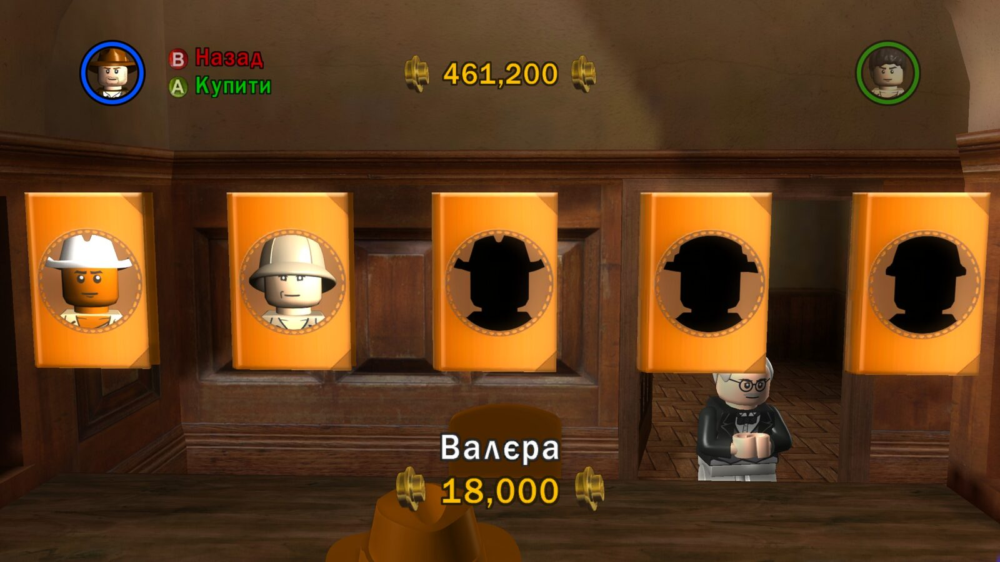
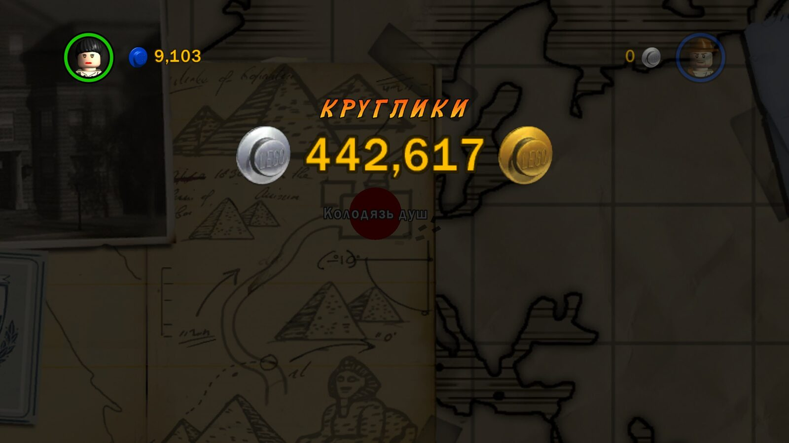

# Cultural adaptations

Most names and titles in the game are translated using established
equivalents: the official Ukrainian dub of the trilogy (ICTV, TV+ studio) and
Ukrainian Wikipedia. But some names were deliberately adapted by the author
so that the game sounds natively Ukrainian rather than like a calque. This
page records those decisions so that nobody "fixes" them by accident.

## Character names

| ID | Original | Literal translation | Ukrainian version | Version |
|---|---|---|---|---|
| 151 | Jungle Guide | Провідник джунглів | **Валєра** (Valera) | 0.1.9 |
| 107 | Boy Scout | Бойскаут | **Пластун** (Plastun) | 0.1.9 |
| 168 | Bandit | Бандит | **Бандюган** (Bandiuhan) | 0.1.9 |
| 184 | Grave Robber 1 | Грабіжник могил 1 | **Чорний археолог 1** (Chornyi arkheoloh — "black archaeologist") | 0.1.9 |
| 185 | Grave Robber 2 | Грабіжник могил 2 | **Чорний археолог 2** | 0.1.9 |
| 186 | Shanghai Hoodlum 1 | Шанхайський хуліган 1 | **Шанхайський батяр 1** (Shanghai batiar) | 0.1.9 |
| 187 | Shanghai Hoodlum 2 | Шанхайський хуліган 2 | **Шанхайський батяр 2** | 0.1.9 |
| 85 | Stranger | Незнайомець | **Форелька** (Forelka; the first custom character) | 0.1.10 |
| — | Stranger 2 | Незнайомець 2 | **Льоля** (Lolia; the second custom character) | 0.1.10 |

### Валєра (Valera)

A deliberate, playful renaming of an ordinary guide, inspired by the
Ukrainian dub of *Cars*. The spelling is specifically «Валєра». The renaming
applies only to ID 151 and does not extend to other guides.

### Пластун (Plastun)

[Plast](https://plast.org.ua/about/) is the Ukrainian scouting organization,
and a «пластун» (plastun) is one of its members. Here «Пластун» is the
cultural equivalent of the Boy Scout role. It is not a claim that a fictional
American character belongs to Plast, nor a universal replacement for the word
"scout" in every context.

### Бандюган, чорний археолог, батяр

- **Бандюган** (bandiuhan) — a colloquial, slightly ironic word for a thug
  that suits a LEGO character better than the dry «бандит» ("bandit"). Other
  bandits in the game keep their names.
- **Чорний археолог** (chornyi arkheoloh, "black archaeologist") — the
  Ukrainian term for illegal diggers who loot heritage sites. It conveys the
  essence of Grave Robber precisely and adds irony in a game about an
  archaeologist.
- **Батяр** (batiar) — a Galician word for a cocky urban rake. «Шанхайський
  батяр» sounds livelier than «хуліган» ("hooligan"). The option «Харциз»
  (khartsyz, "brigand") was considered and rejected. The numbers 1/2 are
  kept.

### Форелька and Льоля (Forelka and Lolia)

The two custom characters in the editor get their names automatically from
ID 85 and a number (`Stranger 1`, `Stranger 2`). The author decided to give
them distinct, affectionate names without numbers: the first is «Форелька»
(Forelka, literally "little trout"), the second «Льоля» (Lolia). Technically,
the plugin redirects the name formatting to achieve this
([character-editor.md](character-editor.md)). Names already written in old
saves stay unchanged.

## Game terms

| Original | Translation | Explanation |
|---|---|---|
| Studs / Treasure (currency) | **круглики** (kruhlyky) | LEGO "studs" are the round bumps on a brick; «круглики» ("little rounds") sounds like money and is not confused with bricks as parts. Ordinary parts remain «цеглинки» (bricks). |
| Treasure Magnet | Магніт кругликів | by the same rule |
| Character Treasure | Круглики за ворогів | defeated enemies drop kruhlyky |
| Poo Treasure | **Какашковий скарб** ("poo treasure") | a deliberate joke exception to the currency rule |
| Extras | Бонуси | menu name |
| Posted | Відправлено | parcel status |
| Parcel / Parcel Detector / Mail Room | Посилка / Детектор посилок / Поштова кімната | |
| Fast Build | Швидке будівництво | |
| Holy Grail | Святий Ґрааль | consistently with `Ґ`, per the current Ukrainian orthography |

All these decisions are recorded in `translations/glossary.json` with the
status `team-approved`. Terms with the status `low-proposal` (for example,
«Мінікіт» for Minikit, «Жетон персонажа» for Character Token) are reasoned
proposals, because no established Ukrainian terminology for LEGO games could
be found publicly.

## Rules for future changes

- An adaptation applies to a specific ID. Do not extend it automatically to
  similar names.
- Keep the variant numbers 1/2 wherever they exist in the original.
- Add a new adaptation to the glossary with an explanation first, and only
  then to the translation.

The full evidence is in the author's research archive.
