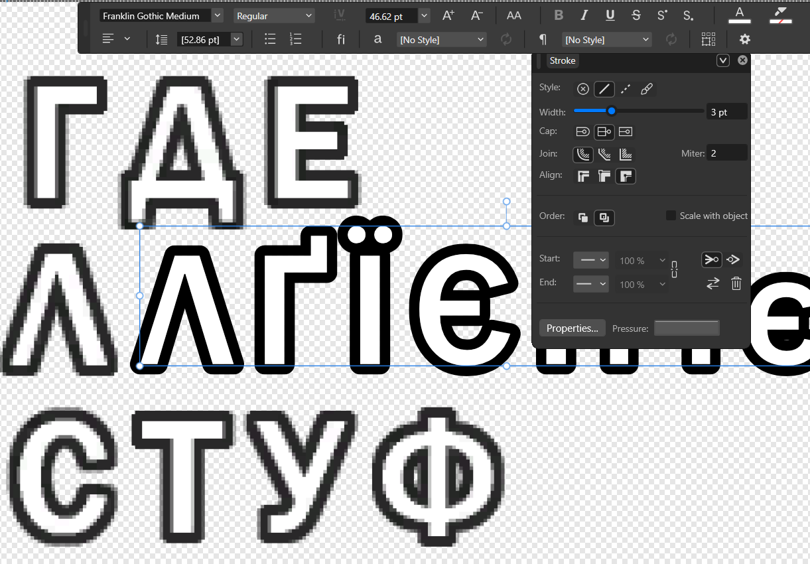

# Fonts: the FNT format, Ukrainian letters and Franklin Gothic Medium

The game does not support any language that uses the letters
`І і Ї ї Є є Ґ ґ`. To display Ukrainian text, these eight letters had to be
added to both of the game's fonts, with neither a format specification nor
developer tools. This page explains how the fonts are structured, how we
changed them and which bugs only showed up in the live game.

## The game's two fonts

| | Font 1 — main interface | Font 2 — "adventure" |
|---|---|---|
| Files | `FONT_PC.FNT`, `PC_FONT.FNT`, `PC_FONT_PC.FNT`, `PC_FONT_NGC.FNT` | `FONT2.FNT`, `FONT2_PC.FNT`, `FONT2_NGC.FNT` |
| Internal name | `starwars_font_pc` — the font carried over from LEGO Star Wars: The Complete Saga | `font2` |
| Look | rounded, white with a dark outline | slanted, orange, in the style of the Indiana Jones posters |
| Where it appears | menus, hints, names, HUD | level-complete screens, parts of the credits |
| Basis of the Ukrainian version | the atlas of a third-party Cyrillic font patch + 6 of our glyphs | the original `FONT2_PC.FNT` + 33 glyphs from the Adventure fan font |

The game looks for the main font under four names and for the second under
three. All names get the same content. In `UKRAINIAN.uap`, identical files
point to shared bytes, so the aliases do not increase the package size.

Where exactly Font 2 is rendered was established by the author through
in-game observation: the level-complete title, "free play unlocked", the
names of newly unlocked characters, "true adventurer", the completion
percentage, treasures and artifacts, "continue story", "Barnett College", and
some lines in the credits.

Gamepad buttons (`A`, `B`, `Y`) are separate fonts, `BUTTONS_*.FNT`, which we
do not modify.

## How `.FNT` is structured

`.FNT` is a binary container of the classic TT Games engine (LEGO Star Wars:
TCS, LEGO Indiana Jones, LEGO Batman). There is no public specification; the
format was reconstructed from bytes, crash dumps and comparison with the
related `.ft2` format. All numbers are little-endian.

```text
0x00  u32  relative address of the relocation footer (NOT magic: "pa"/"pb" is a byte coincidence)
0x08  u32  dds_pointer: the DDS starts at 8 + value
0x1C  u32  number of metric entries
0x20  u32  number of mapping table slots
0x24  f32  height — atlas row height, shared by all glyphs (48 in Font 1)
0x28  f32  base — baseline (37 in the original Font 1)
0x2C  f32  a not yet decoded letter-spacing field
0x44  u32  relative pointer to the metrics  (0x44 + value = 0x60)
0x48  u32  relative pointer to the mapping  (0x48 + value)

0x60  metrics: 12 bytes per glyph = float32 X, float32 Y, float32 Width
      entry address = 0x60 + glyph_index * 12
...   mapping: pairs (u16 codepoint, u16 glyph_index), sorted by codepoint,
      terminator (0xFFFF, 0xFFFF), then zero padding
...   128-byte engine texture descriptor: width, height, mip count, DDS size
...   DDS (DXT5) — the raster atlas with all mip levels
...   relocation footer: u32 count + signed relative offsets to pointer fields
```

A few important consequences:

- **Height is not stored per glyph.** Every atlas row is exactly `height`
  pixels tall, and rows are packed edge to edge. `Width` is both the width of
  the texture region and the pen advance when printing.
- **The mapping table must be sorted.** The engine looks glyphs up with a
  binary search.
- **What precedes the DDS is not empty space but a texture descriptor**, and
  after the DDS comes the footer the engine uses to turn relative pointers
  into absolute ones. Enlarge the atlas without updating them and the game
  crashes.

### How the metrics table was found

The mapping was decoded quickly, but the metrics resisted for a long time:
the first attempt saw `(value, 0.0, 1.0)` triples in them and broke down
somewhere around the 16th entry. The hint came from an open-source parser for
`.ft2`, a newer TT Games font format, in
[TTGames-Explorer-Rebirth](https://github.com/AcK77/TTGames-Explorer-Rebirth)
(`Formats/FT2.cs`). There each glyph is `(X, Y, Width)` plus a shared height.
The same shape was tested against our bytes: the narrow `I` gave
`Width = 13`, the wide `K` 32, `W` 48, `m` 42. The hypothesis held on the
first try. The former "0.0" values turned out to be the `Y = 0` coordinate of
the first atlas row.

### Font 2 and the loader crash

The first Ukrainian build of Font 2 crashed on startup. The dump showed an
`0xC0000005` exception in the game function that walks the container's
relocation footer:

```asm
006ad364 mov ecx, [edx]        ; relative footer address from field 0x00
006ad366 add ecx, edx
006ad36b mov edx, [ecx]        ; entry count
...
006ad37a mov esi, [edx+ecx]    ; crash: address outside the resource
```

When enlarging the atlas from 512×512 to 1024×1024, our old builder dropped
the texture descriptor and the footer and did not update the pointer at
`0x00`. The old address now held pixels of the new DDS, and the engine read
them as the entry count. The new builder keeps the texture descriptor,
recalculates the footer and all pointer/count fields, and validates the
structure after building.

| Field | Original Font 2 | Ukrainian Font 2 |
|---|---:|---:|
| File size | 352 692 | 1 401 908 |
| Atlas | 512×512 | 1024×1024 |
| Metric entries | 165 | 198 |
| Mapping entries | 164 | 230 |
| Relocation entries | 16 | 16 |

The Ukrainian glyphs occupy indices 164–196. Font 2 is an all-caps font, so
the uppercase and lowercase codes of the Ukrainian letters share the same 33
glyphs.

## Font 1: eight letters in someone else's atlas

The base of Font 1 was taken from the atlas of a third-party Cyrillic font
patch for this game. It already had the full Cyrillic alphabet, but without
`І і Ї ї Є є Ґ ґ`. We chose not to add new metric entries to Font 1. Instead
we reused Polish glyphs in the atlas that Ukrainian text does not need
(`Ą Ć Ę ę Ł ń Ś ś`):

1. Repainted the pixels in their rectangles with Franklin Gothic Medium
   letters.
2. Rewrote the codepoint in the mapping table to the Ukrainian one and
   **re-sorted the table** (see bug 1 below).
3. Rewrote `Width` to the real width of the new letter.

`І` and `і` are not drawn at all: they copy X/Y/Width from the Latin `I` and
`i` in the same atlas. The shape is identical, and the clean original glyph is
never recompressed. Only six letters are drawn: `Ї ї Є є Ґ ґ`.

## Where Franklin Gothic Medium comes from

The game's interface font is **Franklin Gothic Medium** with a white fill and
a dark outline. The author identified it visually and confirmed it with an
overlay in Affinity: vector text on top of the pixels of the TT atlas.



In the image, the top and bottom rows are pixels from the game's atlas, and
the middle row is live Franklin Gothic Medium text with these parameters:

| Parameter | Value |
|---|---|
| Typeface | Franklin Gothic Medium, Regular |
| Size | 46.62 pt (leading 52.86 pt) |
| Stroke | 3 pt, **outside** (align outside) |
| Join | round join, miter 2 |
| Fill | solid white, outline dark gray `(41, 40, 41)` |

The outlines match the atlas, so the new letters are drawn with the same font
and the same parameters. Besides our own overlay, a snapshot of the atlas
extracted by a third party was used to cross-check the shapes. We do not
publish it: it is someone else's material.

### Font license

Franklin Gothic Medium is a commercial font (ITC, now Monotype). It is **not
part of Windows**; Microsoft notes that it ships with Office applications.
The author obtained it separately.

- The repository and the release contain **only raster glyphs** of the six
  letters (PNG files and pixels in the `.FNT` atlas). The font file itself is
  nowhere.
- For your own experiments, obtain the font legally, for example with a
  license from the rights holder
  ([ITC Franklin Gothic on MyFonts](https://www.myfonts.com/collections/franklin-gothic-font-itc))
  or bundled with licensed Office, and place it in `local/fonts/`. The
  expected name and SHA-256 are in `manifests/inputs.json`; instructions are
  in [setup.md](../setup.md).

The Adventure font for Font 2 is a fan font by Neale Davidson
([Pixel Sagas](https://www.dafont.com/adventure.font)); check the author's
terms before using it. Its file also lives only in `local/donors/`.

## Sixteen bugs only the live game found

The first build passed every byte-level check: the parser read and wrote the
file losslessly, and the PNG preview on a white background looked right. In
the game, however, this is what turned up.

1. **Unsorted mapping.** Codepoints were changed in place without moving the
   entry. On one screen `і` rendered, on another it did not: the engine's
   binary search went astray. The fix is a full re-sort of the table after
   reassignment.
2. **No fill.** Glyphs were drawn as outlines only. On a white PNG this was
   invisible; in the game the text became almost transparent. The real glyphs
   have a baked-in white fill `(255, 255, 255, 255)`.
3. **Inconsistent scale.** Each letter was scaled separately to fit the donor
   rectangle, and lowercase letters ended up taller than their neighbors. Now
   a single global scale is calibrated on the height of the Cyrillic `О`
   (39 px).
4. **Wrong baseline.** The donor rows reserve room for the "tails" of the
   Polish `Ę ą`, so the bottom edge of a rectangle is not the baseline. It was
   measured on neighboring glyphs without tails.
5. **`Є` almost like `є`.** The safeguard against overflowing the cell
   shrank both dimensions. Now only the width is shrunk.
6. **Rectangles "by eye".** After the metrics were decoded, it turned out the
   rectangles had been taken from the PNG 1–3 px off. Coordinates now come
   from the table.
7. **`Ї` and `Ґ` stuck out upward** past the row. A height limit relative to
   the free space above the baseline was added, as with the stock `Й`.
8. **Extra gap after `і`.** A +6 px side bearing had been tuned on wide
   letters; in the word «Дітріх» (Dietrich) it split the word apart. Reduced
   to 3 px.
9. **Baseline 1 px too high.** Checked on the word «Увімк.» ("On") with its
   underline below the row: a 2 px shift proved too much, so we settled on
   1 px.
10. **DXT5 halo.** Recompressing the whole atlas mixed colors in 4×4 blocks
    bordering neighboring glyphs. Now only the blocks under the mask of our
    glyphs are changed (792 of 65,536), and the clearing area is aligned to
    blocks.
11. **Mip-level halo.** Only mip0 was patched, while mip1 still held the old
    Polish letters. With trilinear filtering they showed through. Now mip0–mip4
    (down to 64×64) are updated.
12. **Trace of a neighboring letter next to `і`/`ї`.** The atlas is clean,
    but the GPU samples a fraction of a pixel outside the rectangle. Widening
    the clearing area was not possible: a genuine `ł` stroke sits right next
    to it. Something else helped: in the glyph viewer, the author narrowed and
    shifted the sampling rectangles themselves, and these manual X/Width
    values are now applied on every build.
13. **Purple blotch in the outline.** Pillow's generic DXT5 encoder chose
    channel colors independently, and the gray pixel `(41, 40, 41)` became
    `(54, 0, 54)`. We wrote our own block encoder that places both endpoints on
    the gray axis `R = G = B`. Interpolating between two grays cannot produce a
    tint.
14. **Dirt under `Ґ`.** Directly below the row sits the acute accent of the
    letter `ź`, which the translation does not use. Its rectangle is erased;
    the mapping stays.
15. **`І`/`і` as Latin letters** — a simplification, not a bug: the metrics
    of the Latin glyphs are copied instead of drawing new ones.
16. **`Є` too narrow.** The width ceiling was the cell of the Polish `Ę`
    (30 px), while a natural `Є` is 36 px. The limit was moved to the actual
    neighbor, and the compression dropped from ~22% to ~6%.

For these checks the author temporarily replaced «Нова гра» ("New Game") with
a string containing all eight letters side by side. That is how bugs 4 and 5
were caught.

## Later fixes

### Gamepad icons above the text (0.1.3)

The donor atlas had `base = 0` instead of the stock 37. The letters did not
move because of it, but the Xbox button icons, which the engine aligns to the
font's baseline, rose above the text. Restoring `base = 37` changed just two
bytes of the float field in each copy of the font.

### Targeting triangle (0.1.10)

Below the throw target, a blue rectangle appeared instead of the lower
triangle. The engine draws the four targeting triangles with the text
renderer:

| Position | Code | Font 1 before the fix |
|---|---|---|
| Bottom | U+00AB | missing |
| Top | U+00A3 | present |
| Left | U+003E | present |
| Right | U+003C | present |

The character addresses are visible in the game code (`0x502371–0x502381`
takes the bottom triangle from `0x90995C` and passes it to the renderer
`0x6997E0`). The donor did contain the actual triangle image, but under code
U+00AC (glyph 21). The fix adds U+00AB as a second mapping to the same glyph.
The new entry occupies 4 bytes of zero padding before the texture descriptor,
so the file size and structure addresses do not change. Checking the runtime
characters generated by the engine itself is now part of the tests: the
ordinary text coverage check does not see them.

## Experiment: ×2 atlas

The author drew a 2048×2048 atlas for sharper text. The game crashed because
the instruction `0x703b3a: mov [eax+0x78], 0x200000` passes DirectX only 2 MiB
as the DDS size. An experimental build of the plugin intercepts the loading of
the font texture specifically and reports the logical 1024×1024 back to the
engine, so the metrics and UVs stay correct. This variant works but is
parked. Along the way it turned out that the overall blurriness came from
`TextureQuality=0` in `pcconfig.txt`, not from the font. The state of the
experiment is described in `experiments/`.

## Tools

- [TT Font Studio](https://github.com/DrSmile444/tt-font-studio) — the
  author's in-browser `.FNT` editor: atlas, rectangles, metrics, text
  preview. It grew out of the glyph viewer in which bugs 12–16 were found.
- `ua/formats/fnt.py` — reading and writing `.FNT`, codepoint reassignment
  with re-sorting, adding glyphs while preserving the service structures.
- `ua/formats/bc_gray.py`, `bc_color.py` — block DXT encoders.

The full evidence is in the author's research archive.
