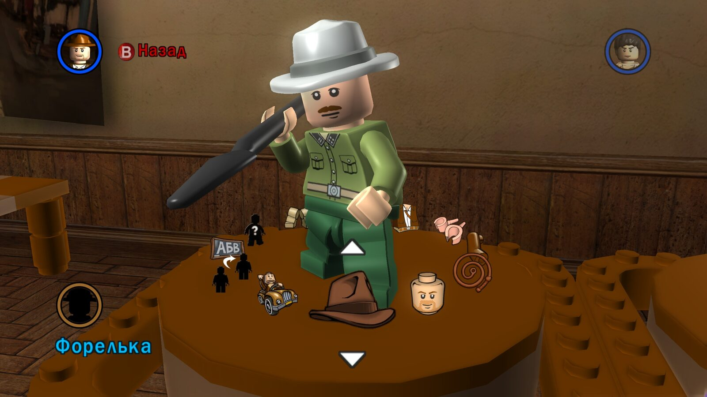

# Редактор власних персонажів: імена, сейви й UTF-8

У грі можна зібрати двох власних персонажів і дати їм імена. Саме тут
український текст уперше вийшов за межі таблиць рядків: імена зберігаються
в сейві, а редактор обробляє їх власним кодом, розрахованим на ASCII.

## Звідки бралися «Stranger 1» і «Stranger 2»

Після перекладу редактор усе одно показував англійські імена. Причина не в
пропущеному рядку: ID 85 (`Stranger`) уже мав переклад. Імена були
**буквально записані в сейві**.

Під час створення імен гра робить таке (Steam EXE):

- функція `0x5F4B40` бере локалізований текст ID 85 через глобальний індекс
  `0x9C5948` і таблицю `0xA90268`;
- додає номер і форматує рядок `%s %i` (`0x8287AC`) викликом на `0x5F4BB2`;
- записує результат у запис персонажа зі зсувом `+0x14`; записи йдуть із
  кроком `0x38`, базова адреса `0x909C80`.

Отже, нова гра отримує імена з активної локалізації, а старий сейв зберігає
те, що в ньому вже записано. Перейменовувати довільні імена під час
завантаження не можна: гравець міг ввести їх сам.

## Формат сейву

Сейви лежать у `%LOCALAPPDATA%\LucasArts\LEGOIndianaJones\SavedGames\`
(наприклад, `SaveGame0.LEGOIndianaJones_SavedGame`).

| Поле | Значення |
|---|---|
| Сигнатура | `HMGR` на початку файла |
| Розмір | 40 880 байтів |
| Імена власних персонажів | 32-байтові поля на `0x9D8C` і `0x9DC4` (крок `0x38`) |
| Контрольна сума | u32 на `40872` |

Контрольна сума — сума little-endian u32 слів діапазону `[8232, 40872)` плюс
`6031769`, за модулем 2³². Параметри звірено з відкритим інструментом
[LEGO Games save file checksum updater](https://github.com/MR-SEVERN-Gaming/Lego-Games-save-file-checksum-updater)
та з незмінним сейвом автора: обчислена й збережена суми збіглися.

Утиліта перейменування сейву створює нову копію й ніколи не перезаписує
джерело. Вона приймає лише точні стандартні `Stranger 1` / `Stranger 2` і
відмовляється чіпати власні імена гравця.

## Краш: UTF-8 у буфері на 16 байтів

Після зміни ID 85 на «Форелька» вхід у редактор почав падати — і зі старим
сейвом, і в новій грі. Дампи показали `0xC0000409` на `0x64C8F4`: спрацювала
перевірка stack cookie наприкінці функції малювання редактора.

Розбір показав дві окремі проблеми.

**Комірки імені.** Редактор показує ім'я по одній комірці на символ (15
комірок). Код на `0x64C509` бере **один байт** імені за індексом комірки й
передає його рендереру `0x69A9C0` (виклик на `0x64C6AF`). Українська літера в
UTF-8 займає два байти, тож комірки показували половинки літер.

**Повне ім'я.** Гетер `0x5B1990` (виклик на `0x64C6FF`) копіює збережене ім'я
в локальний буфер на **16 байтів** без перевірки довжини. `Форелька 1` у
UTF-8 — 18 байтів плюс нульовий байт. Поле сейву на 32 байти вміщує ім'я, але
проміжний буфер редактора — ні, і запис перетирав stack cookie.

### Виправлення

Плагін перевіряє початкові байти трьох інструкцій `CALL` і змінює лише їхні
цільові адреси:

- **комірки** — x86-адаптер зберігає регістри, прапорці й аргументи та передає
  рендереру цілу UTF-8 літеру з потрібної комірки. ASCII-шлях лишається штатним,
  некоректні байти показуються як `?`, читання обмежене 32-байтовим полем;
- **повне ім'я** — гетер перенаправлено в окремий буфер на 1024 байти, а
  виклик малювання повного імені (`0x64C76D`) — на цей рядок;
- **початкові імена** — виклик форматування на `0x5F4BB2` перенаправлено на
  обмежений форматер: номер 1 дає «Форелька», номер 2 — «Льоля», без цифр.
  Цикл створення й скидання імен лишається штатним.

Сейви при цьому не змінюються, а ручне введення імен у грі не переписувалося.

### Тести

x86-тести виконують самі адаптери, а не їхню імітацію:

- відтворюють запис за межу 16-байтового буфера й перевіряють, що з адаптером
  буфер викликача не змінюється;
- перевіряють обидва слоти, імена «Форелька 1», «Незнайомець 1», ASCII-шлях,
  обрізаний UTF-8 і межі буфера;
- викликають форматер через реально переписаний `CALL` і звіряють точні
  UTF-8 байти, значення повернення й контрольне значення за межею поля.

Тести запускаються разом зі smoke test ASI (`native/build.ps1 -SmokeTest`).

## Стрілка вгору

У 0.1.2 автор помітив, що стрілка вгору в редакторі показується
прямокутником відсутнього гліфа, хоча стрілка вниз правильна. Тоді причину
не встановили. У 0.1.10 з'ясувалося, що рушій малює трикутники прицілу
символами шрифту, і в нашому основному шрифті бракувало U+00AB — трикутника
вгору ([fonts.md](fonts.md#трикутник-прицілу-0110)). Після виправлення на
знімку редактора вище обидві стрілки показуються правильно.

Повні докази — в архіві досліджень автора.
