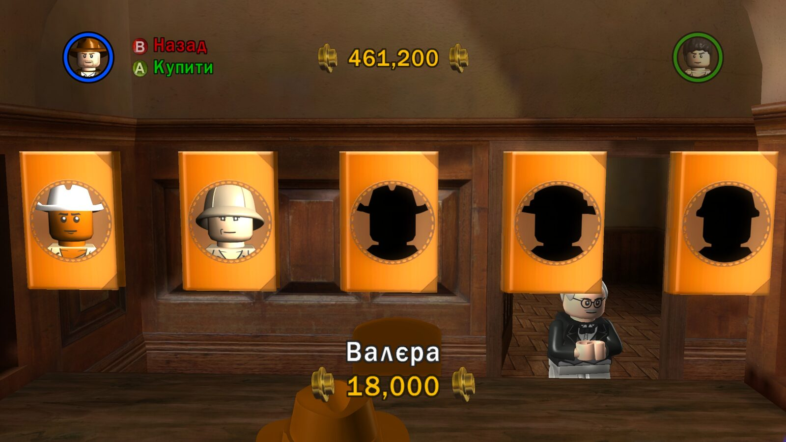
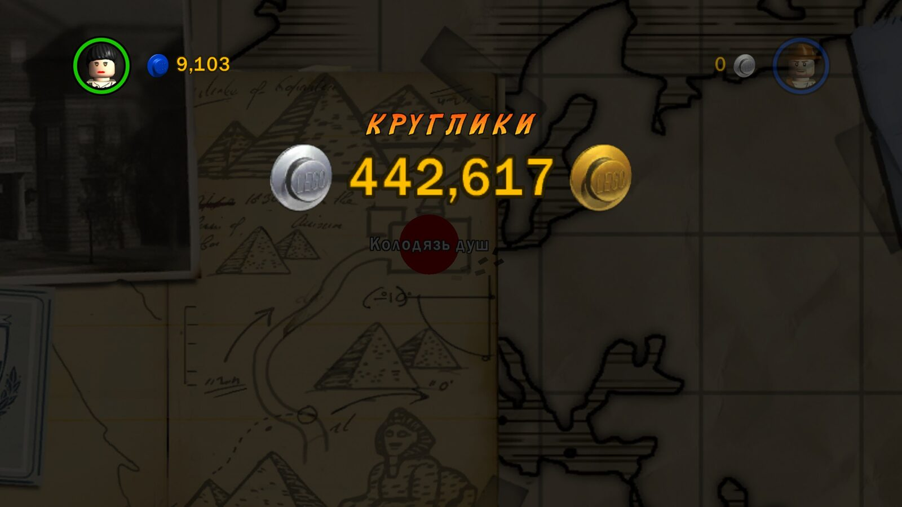

# Культурні адаптації

Більшість імен і назв у грі перекладено за усталеними відповідниками:
офіційний український дубляж трилогії (ICTV, студія «ТВ+») та українська
Вікіпедія. Але частину назв автор свідомо адаптував, щоб гра звучала
по-українськи, а не як калька. Ця сторінка фіксує такі рішення, щоб їх
не «виправили» випадково.

## Імена персонажів

| ID | Оригінал | Буквально | Українська версія | Версія |
|---|---|---|---|---|
| 151 | Jungle Guide | Провідник джунглів | **Валєра** | 0.1.9 |
| 107 | Boy Scout | Бойскаут | **Пластун** | 0.1.9 |
| 168 | Bandit | Бандит | **Бандюган** | 0.1.9 |
| 184 | Grave Robber 1 | Грабіжник могил 1 | **Чорний археолог 1** | 0.1.9 |
| 185 | Grave Robber 2 | Грабіжник могил 2 | **Чорний археолог 2** | 0.1.9 |
| 186 | Shanghai Hoodlum 1 | Шанхайський хуліган 1 | **Шанхайський батяр 1** | 0.1.9 |
| 187 | Shanghai Hoodlum 2 | Шанхайський хуліган 2 | **Шанхайський батяр 2** | 0.1.9 |
| 85 | Stranger | Незнайомець | **Форелька** (перший власний персонаж) | 0.1.10 |
| — | Stranger 2 | Незнайомець 2 | **Льоля** (другий власний персонаж) | 0.1.10 |

### Валєра

Свідоме жартівливе перейменування звичайного провідника, натхненне
українським дубляжем «Тачок». Написання саме «Валєра». Перейменування
стосується лише ID 151 і не поширюється на інших провідників.

### Пластун

[Пласт](https://plast.org.ua/about/) — українська скаутська організація, а
пластун — її член. «Пластун» тут — культурний відповідник ролі Boy Scout.
Це не твердження, що вигаданий американський персонаж належить до Пласту,
і не універсальна заміна слова scout у всіх контекстах.

### Бандюган, чорний археолог, батяр

- **Бандюган** — розмовне, трохи іронічне слово, яке краще пасує
  LEGO-персонажу, ніж сухе «бандит». Інші бандити в грі зберігають свої назви.
- **Чорний археолог** — український термін для незаконних копачів, які
  грабують пам'ятки. Точно передає суть Grave Robber і додає іронії в грі
  про археолога.
- **Батяр** — галицьке слово для зухвалого міського гульвіси. «Шанхайський
  батяр» звучить живіше, ніж «хуліган». Варіант «Харциз» розглядали й
  відхилили. Номери 1/2 збережено.

### Форелька та Льоля

Двоє власних персонажів у редакторі отримують імена автоматично з ID 85 і
номера (`Stranger 1`, `Stranger 2`). Автор вирішив дати їм окремі теплі
імена без номерів: перший — «Форелька», другий — «Льоля». Технічно для цього
плагін перенаправляє форматування імен ([character-editor.md](character-editor.md)).
У старих сейвах уже записані імена лишаються без змін.

## Ігрові терміни

| Оригінал | Переклад | Пояснення |
|---|---|---|
| Studs / Treasure (валюта) | **круглики** | LEGO-«шпильки» — це круглі виступи на цеглинці; «круглики» звучить як гроші й не плутається з цеглинками-деталями. Звичайні деталі лишаються цеглинками. |
| Treasure Magnet | Магніт кругликів | за тим самим правилом |
| Character Treasure | Круглики за ворогів | переможені вороги дають круглики |
| Poo Treasure | **Какашковий скарб** | свідомий жартівливий виняток із правила валюти |
| Extras | Бонуси | назва меню |
| Posted | Відправлено | статус посилок |
| Parcel / Parcel Detector / Mail Room | Посилка / Детектор посилок / Поштова кімната | |
| Fast Build | Швидке будівництво | |
| Holy Grail | Святий Ґрааль | послідовно з `Ґ`, за чинним правописом |

### Чому «круглики»

У LEGO-іграх головна валюта — studs: круглі «пуклі» на верхній частині цеглинки, які розсипаються
з усього, що можна зламати. У цій грі їх ще називають Treasure («скарб»). Готового українського
слова для них немає: глосарій не знайшов усталеної термінології LEGO-ігор ні в Steam-посібниках,
ні в каталогах українізаторів, ні в описах наборів. Тож назву довелося вибирати самим.

| Варіант | Чому ні |
|---|---|
| **Скарб** (як у ранніх версіях до 0.1.5) | дослівно Treasure, але в грі є справжні скарби й артефакти. «Магніт скарбів» і «Скарб x2» плутали гроші з цінними предметами, а у множині («подвійні скарби») звучало дивно |
| **Шпильки**, **шипи** | технічно правильний переклад stud, але для гравця це шпильки для волосся або колючки, а не гроші |
| **Цеглинки** | у грі вже є справжні цеглинки: деталі для збирання та **червоні цеглинки** з бонусами. Валюта й деталі стали б одним словом |
| **Монети** | схоже за змістом, але це загальне слово з будь-якої гри: зникає LEGO-характер і впізнавана форма |

**Круглики** описують саме те, що бачить гравець: круглу деталь, схожу на монетку. Слово українське,
пестливе й грайливе, як і вся гра. Воно легко відмінюється й поєднується: «Магніт кругликів»,
«Круглики x2», «Подвійні круглики!», «Круглики за ворогів». І воно ні з чим у грі не перетинається.
Тому одна назва покриває і Studs, і Treasure. Єдиний свідомий виняток — **какашковий скарб**
(Poo Treasure): це жарт оригіналу, і його варто зберегти.

### Чому «Бонуси», а не «Чити»

Extras — це меню, де відкриваються куплені за круглики модифікатори: магніт кругликів, множники x2–x10,
швидке будівництво, невразливість, кумедні ефекти. Розглядалися такі варіанти:

| Варіант | Чому ні |
|---|---|
| **Додатково** (до 0.1.5) | звучить як «додаткові налаштування». Незрозуміло, що там нагороди |
| **Додатки** | у грі й лаунчерах так називають DLC або програми |
| **Чити** | за суттю близько, але гра подає ці ефекти як заслужені нагороди: їх відкривають червоними цеглинками й купують за круглики. «Чит» звучить як обман і не пасує дитячій грі; крім того, у грі окремо є «Ввести код» для справжніх кодів |
| **Екстри** | калька, яку зрозуміє не кожен гравець |

**Бонуси** — коротке, звичне для ігор слово: так позначають нагороду понад звичайне. Воно вміщується
в пункт меню й узгоджується з рештою текстів: «Бонус розблоковано», «Бонус персонажа»,
«Бонусні круглики», «Бонус за старе збереження».

Усі ці рішення записано в `translations/glossary.json` зі статусом
`team-approved`. Терміни зі статусом `low-proposal` (наприклад, «Мінікіт»,
«Жетон персонажа») — обґрунтовані пропозиції, бо усталеної української
термінології LEGO-ігор публічно не знайшлося.

## Правила для майбутніх змін

- Адаптація стосується конкретного ID. Не поширюйте її автоматично на схожі назви.
- Зберігайте номери варіантів 1/2 там, де вони є в оригіналі.
- Нову адаптацію спершу додайте в глосарій з поясненням, а потім у переклад.

Повні докази — в архіві досліджень автора.
