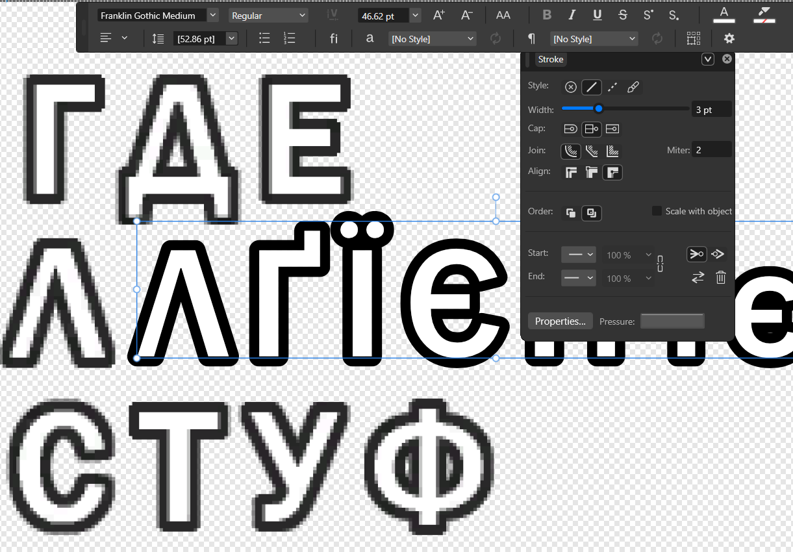

# Шрифти: формат FNT, українські літери й Franklin Gothic Medium

Гра не підтримує жодної мови з літерами `І і Ї ї Є є Ґ ґ`. Щоб показати
український текст, ці вісім літер треба було додати в обидва шрифти гри,
не маючи ні специфікації формату, ні інструментів розробника. Ця сторінка
пояснює, як улаштовані шрифти, як ми їх змінили і які помилки знайшли лише
в живій грі.

## Два шрифти гри

| | Font 1 — основний інтерфейс | Font 2 — «пригодницький» |
|---|---|---|
| Файли | `FONT_PC.FNT`, `PC_FONT.FNT`, `PC_FONT_PC.FNT`, `PC_FONT_NGC.FNT` | `FONT2.FNT`, `FONT2_PC.FNT`, `FONT2_NGC.FNT` |
| Внутрішня назва | `starwars_font_pc` — шрифт перейшов з LEGO Star Wars: The Complete Saga | `font2` |
| Вигляд | округлий, білий з темним обведенням | похилий, помаранчевий, у стилі постерів Індіани |
| Де видно | меню, підказки, імена, HUD | екрани завершення рівня, частково титри |
| Основа української версії | атлас сторонньої кириличної латки шрифту + 6 наших гліфів | оригінальний `FONT2_PC.FNT` + 33 гліфи з фанатського шрифту Adventure |

Гра шукає основний шрифт під чотирма іменами, а другий — під трьома. Усі
імена отримують однаковий вміст. У `UKRAINIAN.uap` однакові файли посилаються
на спільні байти, тож псевдоніми не збільшують розмір пакета.

Де саме рендериться Font 2, автор встановив спостереженням у грі: заголовок
завершення рівня, «вільна гра розблокована», імена щойно відкритих персонажів,
«справжній шукач пригод», відсоток проходження, скарби й артефакти,
«продовжити історію», «Коледж Барнетта», а також окремі написи в титрах.

Кнопки геймпада (`A`, `B`, `Y`) — окремі шрифти `BUTTONS_*.FNT`, які ми не змінюємо.

## Як улаштований `.FNT`

`.FNT` — бінарний контейнер класичного рушія TT Games (LEGO Star Wars: TCS,
LEGO Indiana Jones, LEGO Batman). Публічної специфікації немає; формат
відновлено з байтів, дампів падінь і порівняння зі спорідненим форматом `.ft2`.
Усі числа — little-endian.

```text
0x00  u32  відносна адреса relocation footer (НЕ magic: «pa»/«pb» — збіг байтів)
0x08  u32  dds_pointer: DDS починається з 8 + значення
0x1C  u32  кількість записів метрик
0x20  u32  кількість слотів таблиці mapping
0x24  f32  height — висота рядка атласу, спільна для всіх гліфів (48 у Font 1)
0x28  f32  base — базова лінія (37 в оригінальному Font 1)
0x2C  f32  ще не розшифроване поле міжлітерного проміжку
0x44  u32  відносний вказівник на метрики  (0x44 + значення = 0x60)
0x48  u32  відносний вказівник на mapping (0x48 + значення)

0x60  метрики: по 12 байтів на гліф = float32 X, float32 Y, float32 Width
      адреса запису = 0x60 + glyph_index * 12
...   mapping: пари (u16 codepoint, u16 glyph_index), відсортовані за codepoint,
      термінатор (0xFFFF, 0xFFFF), далі нульове доповнення
...   128-байтний опис текстури рушія: ширина, висота, кількість mip, розмір DDS
...   DDS (DXT5) — растровий атлас з усіма mip-рівнями
...   relocation footer: u32 count + знакові відносні зсуви до полів-вказівників
```

Кілька важливих наслідків:

- **Висота не зберігається на гліф.** Кожен рядок атласу має рівно `height`
  пікселів, рядки йдуть впритул. `Width` — водночас ширина ділянки текстури і
  крок пера при друку.
- **Таблиця mapping має бути відсортована.** Рушій шукає гліф бінарним пошуком.
- **Перед DDS лежить не порожнеча, а опис текстури**, а після DDS — footer, за
  яким рушій перетворює відносні вказівники на абсолютні. Збільшиш атлас,
  не оновивши їх, — гра впаде.

### Як знайшли таблицю метрик

Mapping розшифрували швидко, а метрики довго не піддавалися: перша спроба
бачила в них трійки `(значення, 0.0, 1.0)` і ламалася десь на 16-му записі.
Підказкою став відкритий парсер `.ft2` — новішого шрифтового формату TT Games
з [TTGames-Explorer-Rebirth](https://github.com/AcK77/TTGames-Explorer-Rebirth)
(`Formats/FT2.cs`). Там кожен гліф — `(X, Y, Width)` плюс спільна висота.
Ту саму форму перевірили на наших байтах: вузька `I` дала `Width = 13`,
широка `K` — 32, `W` — 48, `m` — 42. Гіпотеза підтвердилася з першої спроби.
Колишні «0.0» виявилися координатою `Y = 0` у першому рядку атласу.

### Font 2 і краш завантажувача

Перша українська збірка Font 2 падала на старті. Дамп показав виняток
`0xC0000005` у функції гри, яка проходить relocation footer контейнера:

```asm
006ad364 mov ecx, [edx]        ; відносна адреса footer з поля 0x00
006ad366 add ecx, edx
006ad36b mov edx, [ecx]        ; кількість записів
...
006ad37a mov esi, [edx+ecx]    ; падіння: адреса поза ресурсом
```

Наш старий збирач, збільшуючи атлас з 512×512 до 1024×1024, викидав опис
текстури й footer і не оновлював вказівник у `0x00`. За старою адресою вже
лежали пікселі нового DDS, і рушій читав їх як кількість записів. Новий
збирач зберігає опис текстури, перераховує footer і всі pointer/count-поля
та перевіряє структуру після збірки.

| Поле | Оригінальний Font 2 | Український Font 2 |
|---|---:|---:|
| Розмір файла | 352 692 | 1 401 908 |
| Атлас | 512×512 | 1024×1024 |
| Записи метрик | 165 | 198 |
| Записи mapping | 164 | 230 |
| Relocation-записи | 16 | 16 |

Українські гліфи займають індекси 164–196. Font 2 — шрифт великих літер,
тому великі й малі коди українських букв ділять ті самі 33 гліфи.

## Font 1: вісім літер у чужому атласі

Основу Font 1 взято з атласу сторонньої кириличної латки шрифту для цієї гри.
Там уже був повний кириличний алфавіт, але без `І і Ї ї Є є Ґ ґ`. Додавати
нові записи метрик для Font 1 ми не стали. Натомість використали непотрібні
для українського тексту польські гліфи атласу (`Ą Ć Ę ę Ł ń Ś ś`):

1. Перемалювали пікселі в їхніх прямокутниках літерами Franklin Gothic Medium.
2. Переписали codepoint у таблиці mapping на український і **пересортували
   таблицю** (див. помилку 1 нижче).
3. Переписали `Width` на реальну ширину нової літери.

`І` та `і` не малюються взагалі: вони копіюють X/Y/Width латинських `I` та `i`
з того ж атласу. Форма однакова, а чистий оригінальний гліф ніколи не
перестискався. Малюються лише шість літер: `Ї ї Є є Ґ ґ`.

## Звідки Franklin Gothic Medium

Шрифт інтерфейсу гри — **Franklin Gothic Medium** з білою заливкою й темним
обведенням. Автор ідентифікував його візуально й перевірив накладанням в
Affinity: векторний текст поверх пікселів атласу TT.



На знімку верхній («ГДЕ») і нижній («СТУФ») рядки — пікселі атласу гри,
середній рядок — живий текст Franklin Gothic Medium з такими параметрами:

| Параметр | Значення |
|---|---|
| Гарнітура | Franklin Gothic Medium, Regular |
| Кегль | 46,62 pt (інтерліньяж 52,86 pt) |
| Обведення | 3 pt, **назовні** (align outside) |
| З'єднання | округле (round join), miter 2 |
| Заливка | суцільна біла, обведення темно-сіре `(41, 40, 41)` |

Контури збігаються з атласом, тож нові літери малюються тим самим шрифтом
і тими самими параметрами. Крім власного накладання, для звірки форм
використовувався знімок атласу, видобутий сторонньою людиною. Його ми не
публікуємо: це чужий матеріал.

### Ліцензія шрифту

Franklin Gothic Medium — комерційний шрифт (ITC, нині Monotype). Він **не
входить до складу Windows**; Microsoft зазначає, що він постачається з
програмами Office. Автор отримав його окремо.

- У репозиторії й релізі є **лише растрові гліфи** шести літер (PNG і пікселі
  в атласі `.FNT`). Файлу шрифту немає ніде.
- Для власних експериментів отримайте шрифт легально, наприклад з ліцензією
  від правовласника ([ITC Franklin Gothic на MyFonts](https://www.myfonts.com/collections/franklin-gothic-font-itc))
  або разом із ліцензованим Office, і покладіть у `local/fonts/`. Очікувана
  назва й SHA-256 — у `manifests/inputs.json`, інструкція — у [setup.md](../setup.md).

Шрифт Adventure для Font 2 — фанатський шрифт Neale Davidson
([Pixel Sagas](https://www.dafont.com/adventure.font)); перед використанням
перевірте умови автора. Його файл також лежить лише в `local/donors/`.

## Шістнадцять помилок, які знайшла тільки жива гра

Перша збірка пройшла всі байтові перевірки: парсер читав і записував файл без
втрат, PNG-прев'ю на білому тлі виглядало правильно. У грі ж знайшлося ось що.

1. **Невідсортований mapping.** Codepoint змінювали на місці, не переносячи
   запис. На одному екрані `і` малювалася, на іншому — ні: бінарний пошук
   рушія збивався. Рішення — повне пересортування таблиці після перепризначення.
2. **Без заливки.** Гліфи малювалися лише контуром. На білому PNG це було
   непомітно, у грі текст став майже прозорим. Справжні гліфи мають запечену
   білу заливку `(255, 255, 255, 255)`.
3. **Різний масштаб.** Кожна літера масштабувалася окремо під прямокутник
   донора, і малі літери ставали вищими за сусідні. Тепер один глобальний
   масштаб калібрується за висотою кириличної `О` (39 px).
4. **Неправильна базова лінія.** Рядки донорів резервують місце під
   «хвостики» польських `Ę ą`, тому нижній край прямокутника не є базовою
   лінією. Її виміряли на сусідніх гліфах без хвостиків.
5. **`Є` майже як `є`.** Запобіжник від виходу за межі клітинки стискав
   обидва виміри. Тепер стискається лише ширина.
6. **Прямокутники «на око».** Після розшифрування метрик виявилося, що
   прямокутники знято з PNG на 1–3 px не там. Тепер координати беруться з таблиці.
7. **`Ї` і `Ґ` виходили вгору** за межі рядка. Додано обмеження висоти
   відносно вільного місця над базовою лінією, як у штатної `Й`.
8. **Зайвий проміжок після `і`.** Бічний відступ +6 px підібрали на широких
   літерах; у слові «Дітріх» він розривав слово. Зменшено до 3 px.
9. **Базова лінія на 1 px вище.** Перевірено на слові «Увімк.» з рискою під
   рядком: зсув на 2 px виявився забагато, зупинилися на 1 px.
10. **Ореол від DXT5.** Перестискання всього атласу змішувало кольори в
    блоках 4×4 на межі з сусідніми гліфами. Тепер змінюються лише блоки під
    маскою наших гліфів (792 з 65 536), а зона очищення вирівняна по блоках.
11. **Ореол від mip-рівнів.** Патчився лише mip0, а в mip1 лишалися старі
    польські літери. При трилінійній фільтрації вони просвічували. Тепер
    оновлюються mip0–mip4 (до 64×64).
12. **Слід сусідньої літери біля `і`/`ї`.** Атлас чистий, але GPU семплить
    частку пікселя за межею прямокутника. Розширити очищення не вийшло: впритул
    стоїть справжня риска `ł`. Допомогло інше: автор у переглядачі гліфів
    звузив і зсунув самі прямокутники вибірки, і ці ручні X/Width тепер
    застосовуються при кожній збірці.
13. **Фіолетова пляма в контурі.** Загальний DXT5-кодер Pillow підбирав
    кольори каналів окремо, і сірий піксель `(41, 40, 41)` ставав `(54, 0, 54)`.
    Написано власний кодер блоків, який ставить обидві опорні точки на сіру вісь
    `R = G = B`. Інтерполяція між двома сірими кольорами не може дати відтінку.
14. **Бруд під `Ґ`.** Одразу під рядком лежить акут літери `ź`, якої немає в
    перекладі. Її прямокутник стирається; mapping лишається.
15. **`І`/`і` як латиниця** — спрощення, а не баг: копіювання метрик латинських
    гліфів замість малювання.
16. **Надто вузька `Є`.** Стелею ширини була клітинка польської `Ę` (30 px), а
    природна `Є` має 36 px. Межу перенесено до реального сусіда, стиск
    зменшився з ~22 % до ~6 %.

Для таких перевірок автор тимчасово ставив замість «Нова гра» рядок з усіма
вісьмома літерами поруч. Саме так вдалося зловити помилки 4 і 5.

## Пізніші виправлення

### Іконки геймпада над текстом (0.1.3)

Донорський атлас мав `base = 0` замість штатних 37. Літери від цього не
зсунулися, а іконки кнопок Xbox, які рушій вирівнює за базовою лінією
шрифту, піднялися над текстом. Відновлення `base = 37` змінило лише два
байти float-поля в кожній копії шрифту.

### Трикутник прицілу (0.1.10)

Під ціллю кидка замість нижнього трикутника з'являвся синій прямокутник.
Рушій малює чотири трикутники прицілу текстовим рендерером:

| Позиція | Код | Font 1 до виправлення |
|---|---|---|
| Знизу | U+00AB | відсутній |
| Зверху | U+00A3 | є |
| Зліва | U+003E | є |
| Справа | U+003C | є |

Адреси символів видно в коді гри (`0x502371–0x502381` бере нижній трикутник
з `0x90995C` і передає його рендереру `0x6997E0`). Справжнє зображення
трикутника в донорі було, але під кодом U+00AC (гліф 21). Виправлення додає
U+00AB як другий mapping до того самого гліфа. Новий запис займає 4 байти
нульового доповнення перед описом текстури, тож розмір файла й адреси структур
не змінюються. Перевірка рантаймових символів, які генерує сам рушій, тепер
входить до тестів: звичайна перевірка покриття тексту їх не бачить.

## Експеримент: атлас ×2

Автор намалював атлас 2048×2048 для чіткішого тексту. Гра падала, бо
інструкція `0x703b3a: mov [eax+0x78], 0x200000` передає DirectX лише 2 МіБ як
розмір DDS. Експериментальна збірка плагіна перехоплює завантаження саме
текстури шрифту і повертає рушію логічні 1024×1024, щоб метрики й UV лишилися
коректними. Варіант працює, але відкладений. Заодно з'ясувалося, що загальне
розмиття давав `TextureQuality=0` у `pcconfig.txt`, а не шрифт.
Стан експерименту описано в `experiments/`.

## Інструменти

- [TT Font Studio](https://github.com/DrSmile444/tt-font-studio) — браузерний
  редактор `.FNT` автора: атлас, прямокутники, метрики, попередній перегляд
  тексту. Виріс із переглядача гліфів, у якому знайдено помилки 12–16.
- `ua/formats/fnt.py` — читання й запис `.FNT`, перепризначення codepoint із
  пересортуванням, додавання гліфів зі збереженням службових структур.
- `ua/formats/bc_gray.py`, `bc_color.py` — блокові DXT-кодери.

Повні докази — в архіві досліджень автора.
